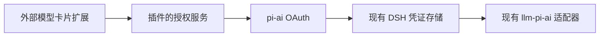

# DSH ChatGPT 订阅插件

独立安装的 Cordis 插件，为 DSH 模型管理中的 `openai` 和 `openai-codex` 卡片增加订阅登录、断开连接及本地授权状态。
插件通过现有页面插槽和公开凭证接口工作，不修改 DSH 源码，也不实现第二套模型适配器。

## 兼容版本

- DSH `0.2.1-rc.3`。
- pi-ai `1.4.0`。
- Node.js `^22.19.0 || >=24.0.0`。

接口仍处于预稳定阶段，请先验证兼容性再升级 DSH 或 pi-ai。

## 本地构建与安装

已有 DSH 源码构建环境时，可以链接其依赖而不修改该仓库。

```sh
node scripts/link-dsh.mjs ../deepseek-harness
node build.mjs
node node_modules/vitest/vitest.mjs run
npm pack --ignore-scripts
```

将生成的包安装到需要使用的 Profile。

```sh
dsh plugin --profile web add --ignore-scripts /absolute/path/dsh-chatgpt-subscription-0.1.1.tgz
```

开发时也可以使用本地链接。

```sh
dsh plugin --profile web add link:/absolute/path/dsh-chatgpt-subscription
```

安装后确认该 Bundle 已启用，并按安装器提示重启 DSH。
Desktop 使用其自带的插件管理器安装同一个包。
`--ignore-scripts` 避免执行 pi-ai 间接依赖的安装脚本，订阅登录使用包内已分发的 JavaScript，不依赖这些脚本。

## 使用

1. 打开“设置 - 模型”，添加或展开 OpenAI 提供商。
2. 保留默认接口配置，点击“使用 ChatGPT 登录”。
3. 打开插件给出的 ChatGPT 登录页面，并在浏览器完成授权。
4. 如果回调没有自动完成，将最终重定向网址粘贴到插件的密码输入框。
5. 新增的提供商需要另行保存，随后即可选择其模型。

推荐使用 `openai` 的官方 ChatGPT 订阅登录。
`openai-codex` 使用 pi-ai 提供的旧版 Codex 协议，授权与 `openai` 分开保存。
插件不会读取或导入 Codex CLI、pi 的登录文件。

如果提供商配置包含 `apiKeyEnv`，该引用的密钥优先于订阅授权。
需要使用订阅时，请移除该提供商的显式 `apiKeyEnv` 配置。
登录成功会将该提供商的凭证记录切换为 OAuth。
断开连接只删除 OAuth 记录，保留 API 密钥记录及其他提供商配置。
插件不会修改 `apiKeyEnv` 引用或其外部密钥。

## 状态、凭证与退出

“已连接”表示 DSH 中保存了该提供商的 OAuth 凭证，不代表实时验证了账户资格、剩余额度或模型访问权限。
访问令牌到期后，现有 `llm-pi-ai` 适配器会在后续请求中刷新凭证。
无法读取的授权显示重新连接提示。

凭证保存在 DSH 自有凭证存储中的 `llm-pi-ai/openai` 或 `llm-pi-ai/openai-codex` 记录中。
插件不另存一份刷新令牌。
浏览器只接收授权状态、登录网址和当前登录问题，不接收访问令牌或刷新令牌。
登录问题及其回答不会成为模型消息或 Session 输入。

官方登录使用一个单独持久化的安装 UUID，默认文件为 `$DSH_HOME/.chatgpt-subscription-host-id`。
这个标识不会复用 DSH 的遥测标识。
文件无法持久化时，插件拒绝启动登录。

“断开连接”先移除本地 OAuth 记录。
官方 `openai` 登录随后尝试向发行方撤销可续期会话。
远端撤销未确认时，界面明确提示到 ChatGPT 中移除此连接。
旧版 Codex 路径只移除本地授权。
已经发送的模型请求不受本地退出影响。

## 配置

```yaml
- id: chatgpt-subscription
  config:
    installationIdPath: /absolute/path/chatgpt-host-id
    loginTimeoutMs: 900000
    revocationTimeoutMs: 15000
```

`installationIdPath` 可省略，其余字段使用示例中的默认值。
同一安装应长期保留同一个安装标识。

## 验证

```sh
node build.mjs
node node_modules/typescript/bin/tsc --project tsconfig.json --noEmit
node node_modules/typescript/bin/tsc --project tsconfig.client.json --noEmit
node node_modules/vitest/vitest.mjs run
node scripts/verify-web.mjs
```

若未安装 Playwright 对应的浏览器，可使用本机 Chrome 运行 `PLAYWRIGHT_CHANNEL=chrome node scripts/verify-web.mjs`。

浏览器验证使用全新临时 Profile，通过真实 DSH Web 页面检查提供商卡片、登录网址、取消登录、合成凭证触发的跨进程授权状态更新和本地退出。
同时检查浅色、深色主题，以及 390px 宽视口中的卡片范围。
390px 宽度下，DSH 现有设置侧栏会压缩内容区，插件卡片没有横向溢出，窄屏阅读仍受该布局限制。
它不打开远端授权页面，不使用个人凭证，也不消费订阅额度。
完整的真实账户登录、授权刷新和推理仍需要用户完成授权后验证。

## 实现



Host 和 Client 均由同一个独立 Bundle 分发。
Host Remote 接口通过公开 Typert 生成器生成验证与编解码器。
Client 通过 `settings.models.provider-card` 插槽接入模型管理。
插件卸载会取消自身未完成的登录并等待已经开始的凭证写入完成。
凭证接口没有条件删除操作，请避免在多个 DSH 进程中同时对同一提供商执行登录和退出。

参考 [OpenAI 官方订阅接入文档](https://developers.openai.com/siwc/token-sharing-open-source) 和 [pi-ai 官方 OAuth 实现](https://github.com/earendil-works/pi/blob/v1.4.0/packages/ai/src/auth/oauth/openai-chatgpt.ts)。
